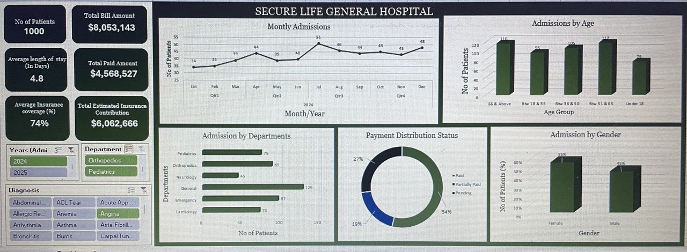

# SECURE LIFE GENERAL HOSPITAL PERFORMANCE DASHBOARD (2024-2025)

## INTRODUCTION

The Secure Life General Hospital Performance Dashboard is an Excel-based data analysis project developed to provide management with a clear overview of hospital activity, patient visits, departmental performance, billing, payment status, insurance coverage, patient demographics, and admission trends.
The project transforms patient-level hospital records into meaningful performance indicators and visual summaries. It is intended to support evidence-based decisions around resource allocation, service delivery, revenue monitoring, and areas that may require management attention.

## ABOUT THE DATA SET
The dataset contains 1,000 patient records covering admissions from 1 January 2024 to 28 December 2025.
[DATA SET](working_on_hospital_sheet.xlsx)

It contains fields relating to: Patient identification and demographics (patient ID, age, gender and age category), Admission and discharge dates, Hospital department and diagnosis, Total bill amount and payment status, Insurance coverage percentage and estimated insurance coverage amount, Patient responsibility amount, length of stay and paid amount.

The records cover six departments: Cardiology, Emergency, General, Neurology, Orthopedics and Pediatrics.

Tools used: Microsoft Excel, including data preparation, formulas, PivotTables and dashboard visualisations.

## PROBLEM STATEMENT 
Hospital management needs reliable information to understand patient demand, departmental workload, revenue generation, payment collection and insurance coverage. Without a consolidated view of these indicators, it may be difficult to identify high-demand departments, monitor outstanding bills, understand admission patterns and prioritise operational improvements.

This project therefore analyses the hospital dataset to answer the following questions:

1.	How many patient visits has the hospital recorded?
2.	Which departments receive the highest number of patients?
3.	Which departments generate the highest total bills?
4.	What is the average length of stay across departments?
5.	What proportion of bills is paid, pending or partially paid?
6.	How much has the hospital billed, and how much remains outstanding?
7.	How does insurance coverage vary across departments and diagnoses?
8.	Which age groups account for the highest number of patient visits?
9.	How do admissions and billing amounts change over time?
10.	Which areas may require management attention?

## DASHBOARD VISUALIZATION

The dashboard provides a visual summary of the hospital's key performance indicators and analysis, including patient visits, departmental activity, billing and payment status, age categories, gender distribution, insurance coverage and admission trends

## KEY INSIGHTS

### Patient visits and departmental activity
•	The hospital recorded 1,000 patient visits during the period covered by the dataset.

•	The General Department recorded the highest number of visits, with 252 patients (25.2%).

•	Emergency recorded 190 visits, Orthopedics 159, Pediatrics 153, Cardiology 152 and Neurology 94.

•	General therefore had the highest patient volume, while Neurology recorded the fewest visits.

### Departmental billing
•	Total hospital bills amounted to approximately $8,053,143.

•	Orthopedics generated the highest total bills, approximately 2,553,862.32, representing about 31.7% of all billed amounts.

•	Cardiology followed with approximately 2,095,437.97, while Neurology generated approximately 1,215,302.99.

•	Pediatrics generated the lowest total bills, approximately 572,987.96.

### Average length of stay
•	The overall average length of stay was approximately 4.81 days.

•	Orthopedics had the longest average stay at 8.38 days, followed by Neurology at 6.91 days and Cardiology at 6.49 days.

•	Emergency had the shortest average stay at 2.03 days.

### Payment status and outstanding bills
•	56.4% of patient records were marked Paid.

•	25.7% were marked Pending.

•	17.9% were marked Partially Paid.

•	The total amount billed was approximately $8,053,143.

•	The Paid Amount field totals approximately $4,568,527. The difference is approximately $3,484,616.

## Important data limitation 

The workbook's Paid Amount calculation records the full bill for records marked Paid and zero for records marked Pending or Partially Paid. It does not capture the actual amount already paid against partially paid bills. Therefore, $3,484,616 should be treated as the amount not captured as paid in the workbook, rather than a confirmed outstanding balance. Actual outstanding balances should be recalculated using the amount received for every patient, including partial payments.

### Insurance coverage
•	The average insurance coverage percentage across patient records was approximately 74.9%.

•	Average coverage was highest in Cardiology (76.3%) and Emergency (76.2%).

•	General had the lowest average coverage (73.9%), although the difference between departments was relatively small.

•	At diagnosis level, coverage varied. For example, Fracture had an average coverage of approximately 78%, while Diabetes Management was approximately 70%.

### Patient age groups
•	Patients aged 51–65 accounted for the highest number of visits, with 235 records (23.5%).

•	Patients aged 66 and above followed closely, with 232 visits (23.2%).

•	The under-18 age group recorded the fewest visits, with 153 (15.3%).

### Admission and billing trends
•	The dataset recorded 508 visits in 2024 and 492 visits in 2025, a slight decrease of approximately 3.1%.

•	Total bills decreased from approximately $4,132,465 in 2024 to $3,920,678 in 2025.

•	November 2025 recorded the highest monthly patient volume, with 57 visits.

•	November 2025 also recorded the highest monthly billed amount, approximately $510,413.

## RECOMMENDATIONS 

1.	Review capacity in high-volume departments: The General Department recorded the highest patient volume. Management should assess staffing, waiting times, equipment and other operational resources to ensure service capacity matches demand.
2.	Monitor high-billing departments: Orthopedics and Cardiology generated the largest shares of hospital bills. Management should monitor their costs, billing accuracy, service demand and revenue performance.
3.	Investigate longer hospital stays: Orthopedics, Neurology and Cardiology had the longest average stays. Reviewing discharge processes, treatment pathways and bed utilisation may help improve efficiency without compromising patient care.
4.	Strengthen payment follow-up: Pending and partially paid records account for a substantial share of patient records. A patient-level receivables tracker should capture total bills, amounts received, balances due and payment dates.
5.	Improve payment data quality: Record actual partial payments rather than assigning zero paid amount to every partially paid bill. This will make outstanding-balance reporting more accurate.
6.	Review insurance arrangements: Management may examine insurance coverage and reimbursement patterns across departments and diagnoses, particularly where coverage is comparatively lower.
7.	Plan services around patient demographics: The 51-and-above age groups account for a large proportion of visits. Management should consider their service needs when planning clinical resources and patient support.
8.	Continue monitoring monthly trends: Monthly admissions and billing should be reviewed regularly to identify unusual increases or decreases and support staffing, inventory and budget planning.

## CONCLUSION

The analysis provides an overview of Secure Life General Hospital's performance across patient visits, departmental activity, billing, payment status, insurance coverage, length of stay and admission trends. It identifies General as the busiest department and Orthopedics as the highest billing department. It also highlights the importance of monitoring longer stays and improving the accuracy of payment records.
Overall, the dashboard offers management a practical starting point for evidence-based planning. The reliability of future financial insights will improve when partial payments and actual outstanding balances are captured accurately.
